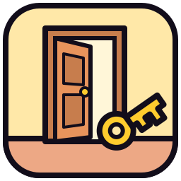
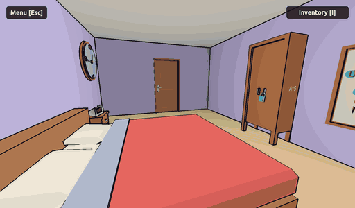
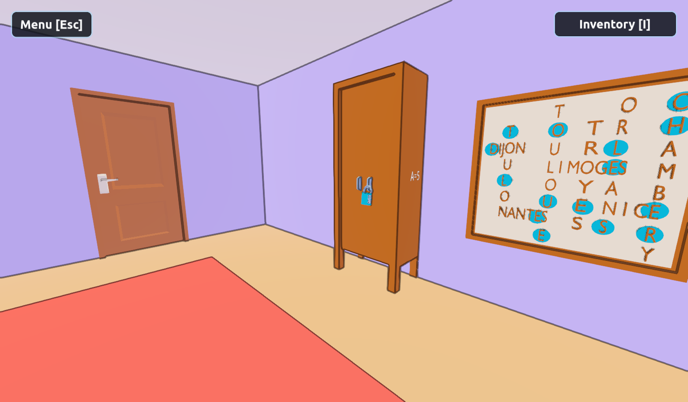
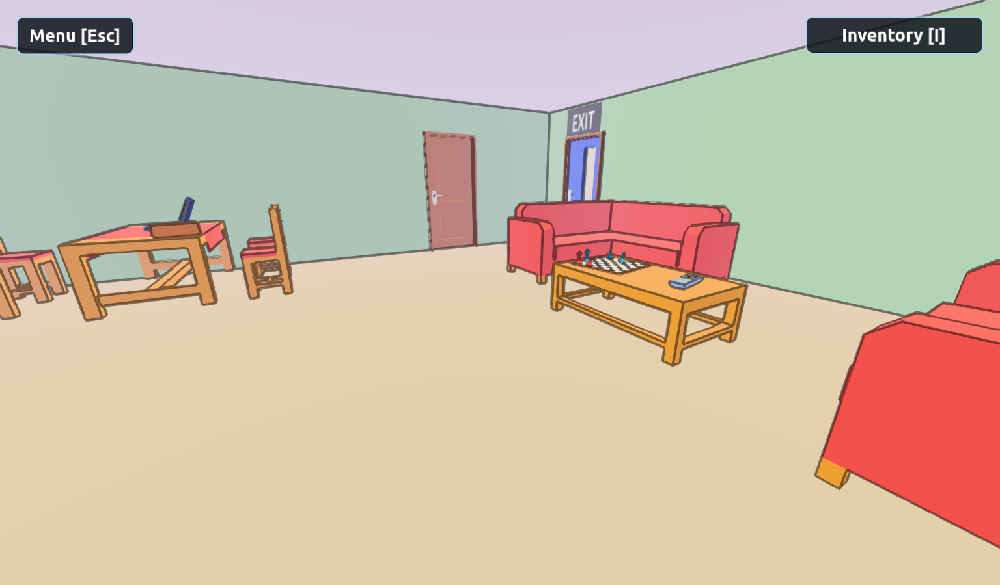
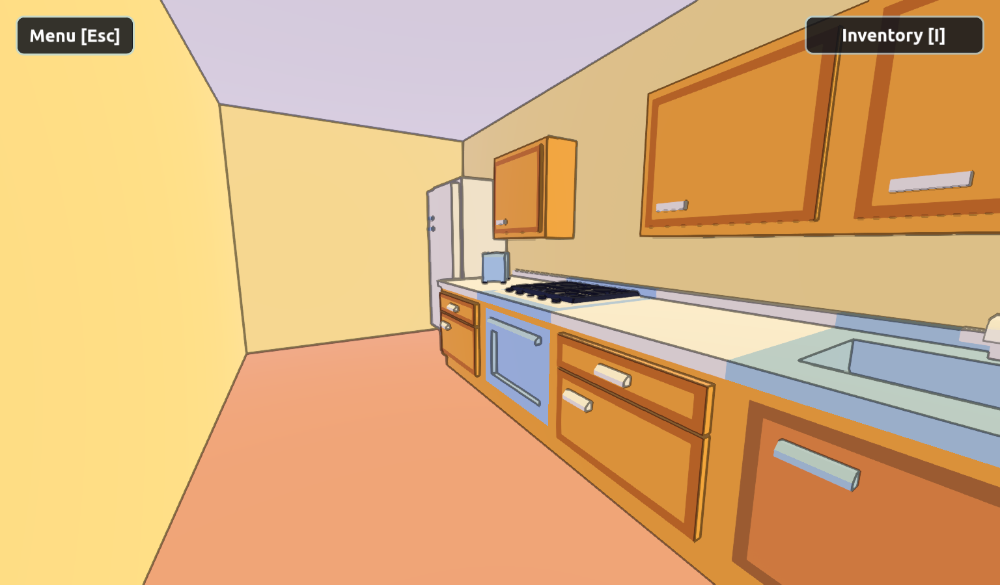
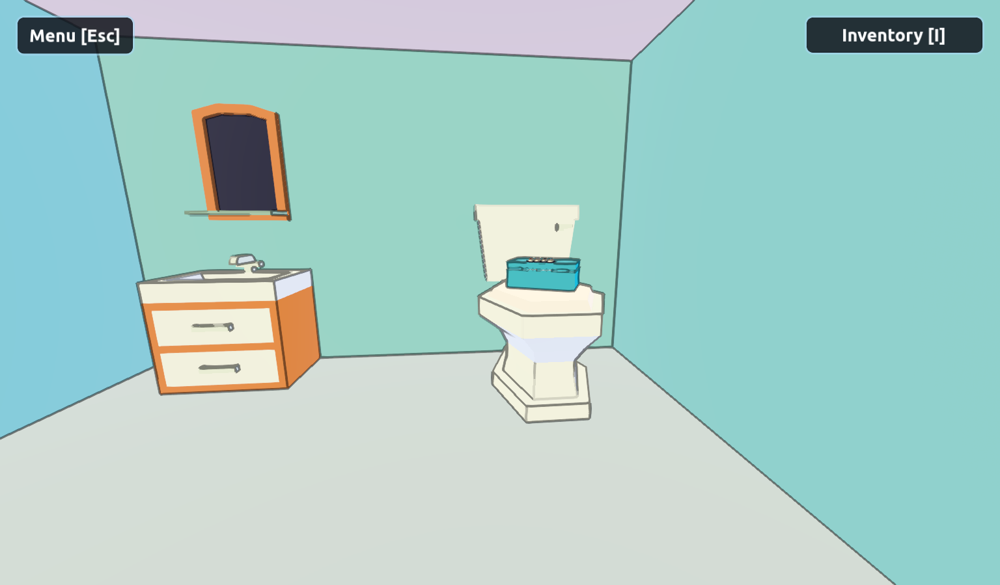
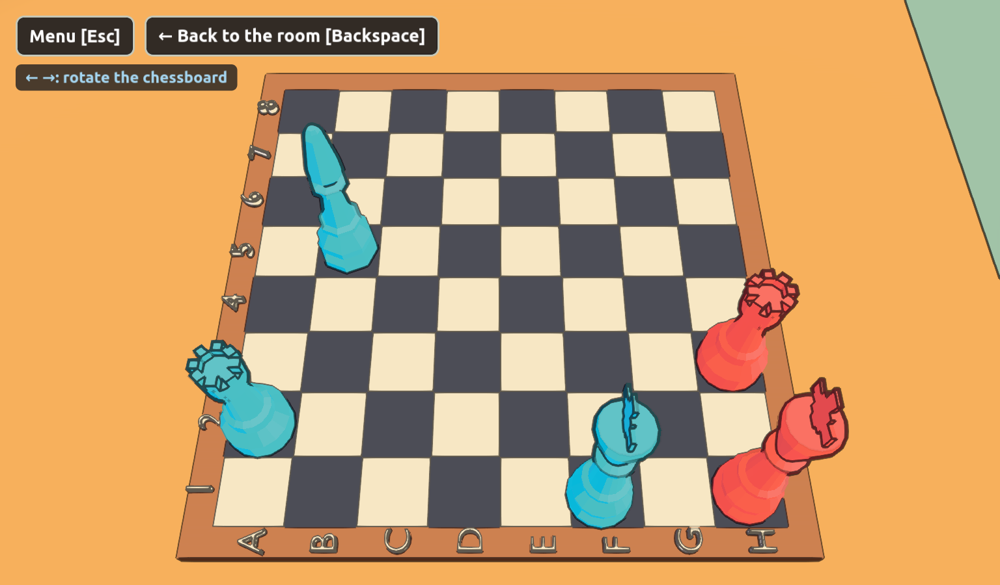
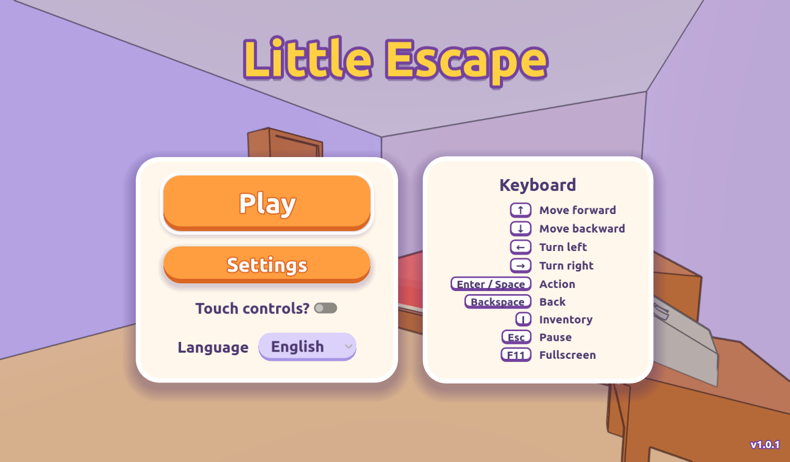

<div align="center">



# 🚪 Little Escape

**A cartoon escape game: find the clues, the keys and the codes to get out of the flat.**

<a href="https://dupot-org.itch.io/little-escape"></a>

*Search every room, solve the puzzles and open the exit door.*

**[▶ Play it in your browser](https://dupot-org.itch.io/little-escape)**

Free · Linux x86_64 · Web · English & French · Made with Godot 4.7

[](https://dupot-org.itch.io/little-escape)
[](https://godotengine.org)
[](LICENSE)

</div>

---

## 📖 About

You wake up locked in a small flat. The only way out is the **exit door**, and its key is well hidden.

- 🛏️ **Four rooms to search**: the bedroom, the bathroom, the living room and the kitchen
- 🔑 **Keys and locked doors**: each room opens the way to the next one
- 🔍 **Close-ups**: look closely at the closet, the chessboard, the remote control or the secret boxes to find what they hide
- 🔢 **Codes and clues**: sticky notes, a crossword board, a clock... everything can be a hint
- 🎨 **Cartoon look**: flat colors and outlines, a colored theme for each room

## 📸 Screenshots

<div align="center">

| The bedroom | The living room | The kitchen |
|:---:|:---:|:---:|
|  |  |  |

| The bathroom | The chessboard | Main menu |
|:---:|:---:|:---:|
|  |  |  |

</div>

## 🎮 Controls

| Action | Keyboard |
|---|---|
| Move forward / back | ↑ ↓ arrow keys |
| Turn | ← → arrow keys |
| Look up / down | `Page Up` / `Page Down` |
| Action (open, take, use) | `Enter` or `Space` |
| Back to the room / inventory | `Backspace` |
| Inventory | `I` |
| Menu | `Esc` |
| Fullscreen | `F11` |

🎮 Gamepads are supported too, and touch controls can be turned on from the main menu.

## 📦 Install

### Flathub (Linux, recommended)

```bash
flatpak install flathub org.dupot.littleescape
flatpak run org.dupot.littleescape
```

You can also install it from GNOME Software, KDE Discover or any app store that uses Flathub.

### Snap Store (Linux)

```bash
sudo snap install dupot-little-escape
```

### itch.io (browser)

Play it in your browser, no install needed: **[dupot-org.itch.io/little-escape](https://dupot-org.itch.io/little-escape)**

## 🛠️ Build from source

1. Install [Godot 4.7](https://godotengine.org/download) and its export templates (Linux, Web).
2. Clone the repository:
   ```bash
   git clone https://github.com/imikado/dupotLittleEscape.git
   ```
3. Open `project.godot` in Godot and press **F5** to play.

Export presets for **Linux** and **Web** are included in `export_presets.cfg`.

Helper scripts (set `GODOT` if Godot isn't in your `PATH`):

| Script | What it does |
|---|---|
| `./export_html5.sh` | Exports the web build to `export/HTML5/` and zips it for itch.io |
| `./export_flathub.sh` | Exports the `.pck` and builds `export/Linux/bundle.tar.gz` (the GitHub release asset used by the Flathub manifest), and prints its sha256 |
| `./build_snap.sh [--install]` | Exports the game and packs the `.snap` in `export/Linux/snap/` (needs `snapcraft`) |
| `tools/capture/capture.sh` | Records a guided tour of the flat and regenerates the screenshots and the promo GIF (needs `ffmpeg`, takes about 7 minutes) |
| `tools/capture/video.sh` | Records the guided tour in 1920x1080 and edits the YouTube promo video `export/promo/little_escape.mp4` (title, captions, end screen with links; `MUSIC=file.ogg` adds a soundtrack; needs `ffmpeg`, takes about 10 minutes) |
| `tools/capture/screenshots.sh [shot...]` | Regenerates only the screenshots, with the same shots as `capture.sh` (a few seconds, no `ffmpeg`) |
| `tools/capture/gif.sh` | Regenerates only the promo GIF `export/promo/little_escape.gif`, recording just the GIF shots (`GIF_SHOTS="..."` changes them; needs `ffmpeg`, takes about 3 minutes) |
| `godot --headless --path . -s tools/icons/generate_icons.gd` | Regenerates the PNG icons from `tools/icons/icon.svg` |

### Releasing a new version

1. Add a `<release version="X.Y.Z">` at the top of `<releases>` in `export/Linux/flatpak/org.dupot.littleescape.appdata.xml`.
2. Run `./update_version.sh` to copy the version to `project.godot` and `snapcraft.yaml`.
3. If the screenshots changed, commit and push them first: `export_flathub.sh` points the appdata screenshot URLs to the commit that last changed them.
4. Run `./export_flathub.sh`, `./build_snap.sh` and `./export_html5.sh`, then upload the builds (GitHub release `X.Y.Z` with `bundle.tar.gz`, Snap Store, itch.io).

## 🕹️ More from dupot.org

Also on Flathub from the same developer:

- **Save the Sheep**
- **Little Adventure**
- **Beat And Match To Pass**
- **Easyflatpak**

See them all on [dupot.org](https://www.dupot.org/games.html).

## 🐛 Feedback

Found a bug or have an idea? [Open an issue](https://github.com/imikado/dupotLittleEscape/issues).

## 📜 License

This game is released under the [GNU LGPL v2.1](LICENSE).

---

<div align="center">

Made with ❤️ and [Godot Engine](https://godotengine.org) by [Michael Bertocchi](https://www.dupot.org/games.html) · [dupot.org](https://www.dupot.org)

</div>
